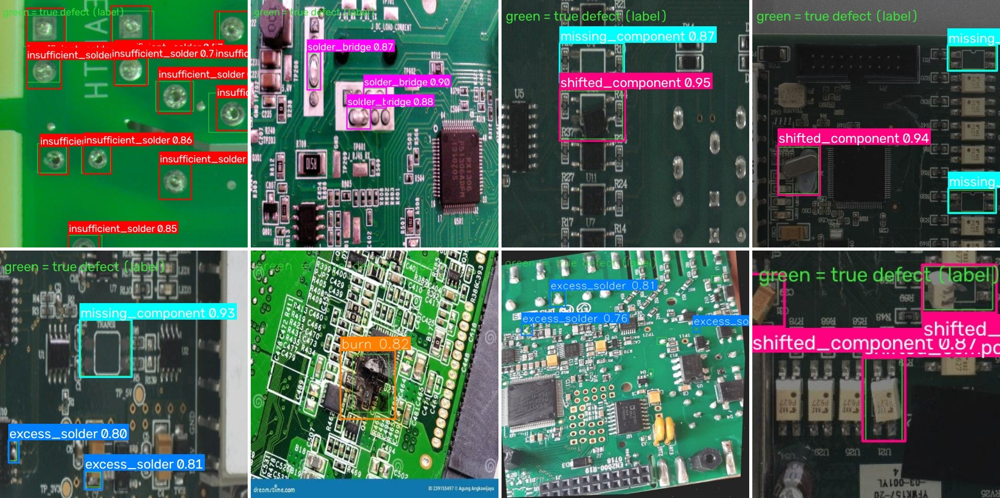
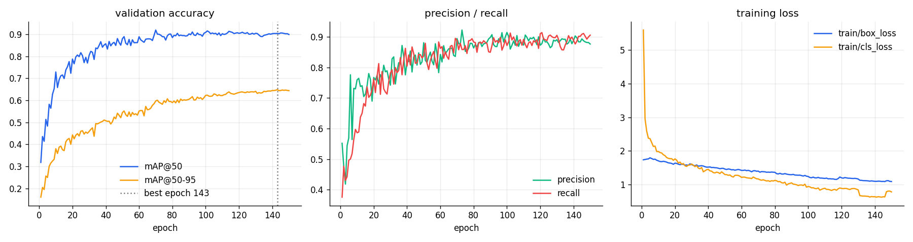
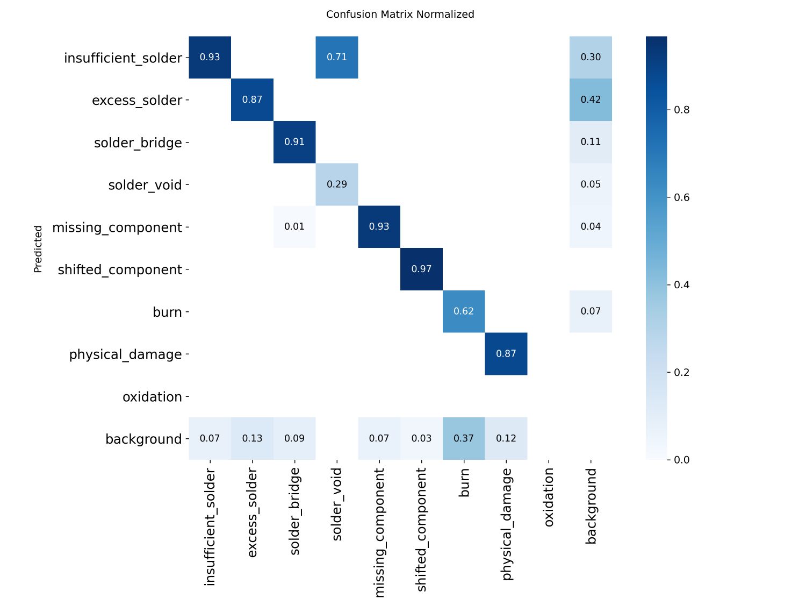
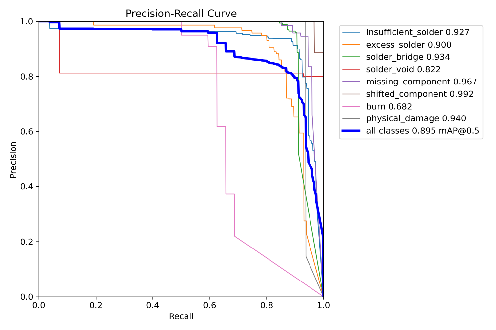
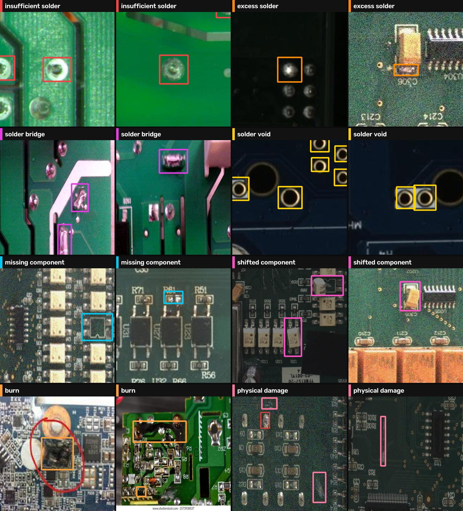
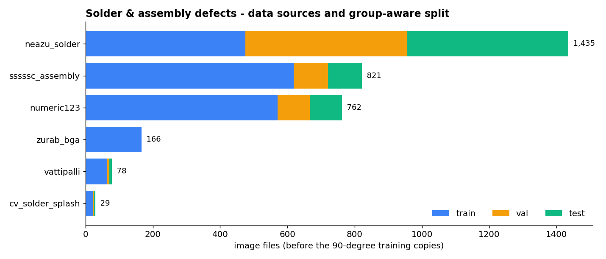
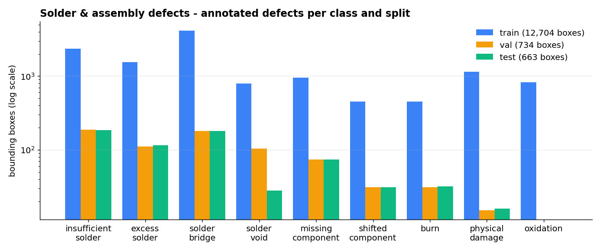

<h1 align="center">PCB Solder &amp; Assembly Defect Detection — YOLO26</h1>

<p align="center">
  <strong>Automated optical inspection (AOI) for assembled circuit boards. A YOLO26 detector that finds soldering and assembly defects: insufficient solder, excess solder, solder bridges, voids, missing and shifted components, burns and physical damage.</strong>
</p>

<p align="center">
  
  
  
  
  
  
</p>

<p align="center">
  <a href="https://huggingface.co/ParsaVictor/pcb-solder-defect-detection-yolo26"></a>
  <a href="https://huggingface.co/datasets/ParsaVictor/pcb-solder-defect-detection"></a>
  <a href="https://huggingface.co/ParsaVictor/pcb-inspection-suite"></a>
  <a href="https://huggingface.co/ParsaVictor"></a>
</p>

<p align="center">
  
  <br><em>Predictions on <b>test</b> photos the model never saw in training or model selection. Thin green boxes = ground truth.</em>
</p>

## At a glance

| | |
|---|---|
| **Task** | Detect soldering and assembly defects on populated PCBs (post-reflow AOI) |
| **Model** | Ultralytics YOLO26m · 21.8 M parameters · 800 px input · tiled inference for large photos |
| **Test accuracy** | **mAP@50 0.895 · mAP@50-95 0.657** on boards never seen in training |
| **Validation accuracy** | mAP@50 0.904 · mAP@50-95 0.648 (best of 150 epochs, epoch 143) |
| **Speed** | ~86 ms per image on a Tesla T4 |
| **Data** | 1,557 unique real photos from 6 public sources, cleaned and split by physical board |
| **Weights** | [`weights/best.pt`](weights/) (44 MB) + per-class thresholds |

## Results on the test set

Each class has its own confidence threshold, tuned for the best F1 score on validation. Recall and precision below are measured with those thresholds on the test set.

| Defect | Test boxes | mAP@50 | mAP@50-95 | Recall | Precision |
|---|---|---|---|---|---|
| `shifted_component` | 31 | **0.992** | 0.898 | 96 % | 100 % |
| `missing_component` | 74 | **0.967** | 0.806 | 93 % | 94 % |
| `physical_damage` | 16 | 0.940 | 0.683 | 94 % | 93 % |
| `solder_bridge` | 181 | **0.934** | 0.653 | 88 % | 96 % |
| `insufficient_solder` | 186 | 0.927 | 0.537 | 92 % | 81 % |
| `excess_solder` | 115 | 0.900 | 0.562 | 87 % | 80 % |
| `solder_void` | 28 | 0.822 | 0.573 | 29 % | 62 % |
| `burn` | 32 | 0.682 | 0.545 | 62 % | 76 % |
| **All classes** | **663** | **0.895** | **0.657** | | |

<p align="center">
  
</p>

<p align="center">
  
  
</p>

### Known limitations

- **`solder_void` is often labelled `insufficient_solder`** (71 % of test voids in the confusion matrix). Both look like an incomplete joint, and most voids come from one source with very dark photos. AP is still 0.82, but at the tuned threshold only 29 % of voids are reported.
- **`burn` has the lowest recall (62 %).** It has few real training photos, and burns vary a lot in shape and size.
- **Very dark images** (one source shot at low exposure) are the weakest case. Brighten such photos before inference, or add photos from your own line.
- **`oxidation`** has training examples only, with none in validation or test, so it cannot be scored yet.

## Defect classes

<p align="center">
  
</p>

| Class | Meaning |
|---|---|
| `insufficient_solder` | too little solder: dry joint, exposed pad |
| `excess_solder` | too much solder: balled joint, splash |
| `solder_bridge` | solder shorts two pins or pads |
| `solder_void` | hole or blow-hole in the joint |
| `missing_component` | empty footprint |
| `shifted_component` | part rotated or displaced off its pads |
| `burn` | burnt or charred area |
| `physical_damage` | crack, chip, broken trace or connector |
| `oxidation` | corrosion on leads and pads (training only) |

## How it was built

**Data.** More than 50 public Roboflow PCB datasets were audited, and most turned out to be resized copies of the same few hundred photos. Only sources with genuinely new images were kept. Their class names were mapped into one taxonomy ([`configs/families.yaml`](configs/families.yaml)). Photos of the same physical board always go to the same split (matched by file-name pattern or SIFT image matching), so near-duplicates cannot inflate the test score. Validation and test contain real photos only: AI-generated, watermarked and pre-augmented images are used for training only. Large 5472 px photos are tiled into 1280 px crops.

<p align="center">
  
  
</p>

**Training: from a diverging run to a stable one.** The first full run used AdamW with `lr0=1e-3`. It peaked at epoch 4 (mAP@50-95 0.18), then diverged: the training classification loss jumped from 2.7 to 26 just as warm-up ended. The cause was that an explicit `optimizer="AdamW"` keeps Ultralytics' SGD default `warmup_bias_lr=0.1`. The final recipe changed four things:

- `lr0` lowered to 5e-4 with a cosine schedule;
- `warmup_bias_lr` set to 0, with 5 warm-up epochs;
- a **guard** that restores the best weights and halves the learning rate if the loss spikes;
- noise, motion-blur and JPEG augmentation.

That took mAP@50-95 from 0.18 to **0.65**. The full log is in [`docs/training_log.md`](docs/training_log.md).

## Quick start

```bash
git clone https://github.com/ParsaVictor/pcb-solder-defect-detection-yolo26.git
cd pcb-solder-defect-detection-yolo26
pip install -r requirements.txt

python infer/predict.py --weights weights/best.pt --source path/to/photos --out results/run1
```

For each image this writes `<name>_annotated.jpg`, `<name>.json` (class, confidence, box) and a `summary.csv`. Photos wider than 2000 px are cut into overlapping tiles and merged with NMS. Per-class thresholds are read from `weights/thresholds.json`; `--conf 0.3` sets one threshold for all classes instead.

```python
from ultralytics import YOLO

model = YOLO("weights/best.pt")
for box in model.predict("board.jpg", imgsz=800, conf=0.3)[0].boxes:
    print(model.names[int(box.cls)], round(float(box.conf), 2), box.xyxy[0].tolist())
```

## Train on Google Colab

Open [`notebooks/Solder_Model_Colab.ipynb`](notebooks/Solder_Model_Colab.ipynb), put `solder_data.zip` in Google Drive and choose *Run all*. On a free T4 it takes about 4.7 minutes per epoch. The notebook shows a live training panel and saves checkpoints to Drive every 2 epochs. It resumes automatically after a disconnect, even from another Google account. At the end it writes the per-class thresholds and a test report.

```bash
python train/train_solder.py --data final_solder --work runs --drive /content/drive/MyDrive/runs/solder \
       --model yolo26m.pt --imgsz 800 --epochs 150 --patience 50
```

To rebuild the dataset: `ROBOFLOW_API_KEY=... python tools/download_versions.py && python run_pipeline.py`.

## Repository layout

```
weights/     best.pt · thresholds.json · summary.json
infer/       predict.py — tiled inference, per-class thresholds, JSON/CSV output
train/       train_solder.py (training, divergence guard, Drive sync) · panel.py (live panel)
notebooks/   one-click Colab notebook
tools/       dataset audit, de-duplication, board-level split, verification
configs/     class taxonomy and source-to-class mapping
results/     results.csv · training curves · confusion matrix · PR curve
docs/        training log · dataset report
```

## FAQ

**What does this model detect?**
Soldering and assembly defects on assembled PCBs: insufficient or excess solder, solder bridges, voids, missing or shifted components, burns and physical damage.

**How accurate is it?**
On held-out test boards it reaches mAP@50 = 0.895 and mAP@50-95 = 0.657. Placement defects (missing or shifted parts) and solder bridges score highest, at 0.93–0.99.

**Can it run without a GPU?**
Yes. Inference falls back to the CPU automatically; one 800 px image takes about 3 seconds on a laptop CPU (measured on this repository's development machine).

**How do I adapt it to my production line?**
Add 50–100 labelled photos from your own boards to the training split and retrain with the notebook. For very small joints, raise `--imgsz` to 1024.

## Related repositories

| Repository | What it does |
|---|---|
| [pcb-bare-board-defect-detection-yolo26](https://github.com/ParsaVictor/pcb-bare-board-defect-detection-yolo26) | copper and drilling defects on bare boards, before assembly |
| [pcb-component-detection-yolo26](https://github.com/ParsaVictor/pcb-component-detection-yolo26) | locates and identifies every component on a board |
| [pcb-component-classifier](https://github.com/ParsaVictor/pcb-component-classifier) | explainable Random-Forest classifier for component crops |

## Citation

```bibtex
@software{karkooti_2026_pcb_solder_defects,
  author = {Karkooti, Mohammad Parsa},
  title  = {PCB Solder and Assembly Defect Detection with YOLO26},
  year   = {2026},
  url    = {https://github.com/ParsaVictor/pcb-solder-defect-detection-yolo26}
}
```

## License

Code and weights are MIT-licensed ([LICENSE](LICENSE)). The training images come from public Roboflow Universe datasets under their own licences, listed in [`configs/downloads.csv`](configs/downloads.csv).

**Author:** Mohammad Parsa Karkooti, AI Engineer (Computer Vision) · [GitHub](https://github.com/ParsaVictor) · [LinkedIn](https://www.linkedin.com/in/parsa-karkooti) · [Email](mailto:1.parsa.karkooti@gmail.com)

<sub>Keywords: PCB defect detection, solder joint inspection, automated optical inspection, AOI, SMT defect detection, solder bridge detection, YOLO26, object detection, printed circuit board quality control, electronics manufacturing.</sub>
