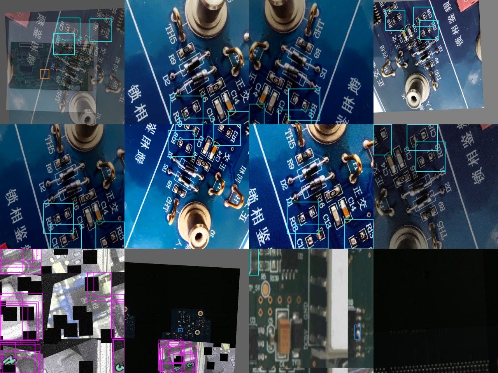

<h1 align="center">PCB Solder &amp; Assembly Defect Detection — YOLO26</h1>

<p align="center">
  <strong>Automated optical inspection (AOI) of assembled printed circuit boards: a YOLO26 detector that finds 9 kinds of soldering and assembly defects — insufficient solder, excess solder, solder bridges, voids, missing / shifted components, burns, physical damage and oxidation.</strong>
</p>

<p align="center">
  
  
  
  
  
  
  
</p>

<!--PRED
<p align="center">
  
  <br><em>Detections of the trained model on held-out test photos (never seen during training or model selection).</em>
</p>
PRED-->

---

## At a glance

| | |
|---|---|
| **Task** | Object detection of soldering / assembly defects on populated PCBs (post-reflow AOI) |
| **Model** | Ultralytics **YOLO26m**, 800 px input, tiled inference for large photos |
| **Accuracy (validation)** | **mAP@50 = 0.904 · mAP@50-95 = 0.648 · Precision 0.884 · Recall 0.902** |
| **Improvement** | mAP@50-95 **0.182 → 0.648 (×3.6)** over the first training recipe, after diagnosing a divergence |
| **Data** | 1,557 unique real photos from 6 public sources, cleaned, de-duplicated, split by physical board |
| **Weights** | [`weights/best.pt`](weights/) — 44 MB, ready to run, plus per-class confidence thresholds |
| **Hardware** | Trained on a free Google Colab **Tesla T4** (~4.8 min / epoch); inference runs on CPU or GPU |

## Defect classes

<p align="center">
  
  <br><em>Two real annotated examples per class, taken from the validation and test splits.</em>
</p>

| # | Class | What it means on the board |
|---|---|---|
| 0 | `insufficient_solder` | Too little solder — dry joint, exposed pad or open fillet |
| 1 | `excess_solder` | Too much solder — balled joint, solder splash |
| 2 | `solder_bridge` | Solder connects two pins / pads that must be isolated (short circuit) |
| 3 | `solder_void` | Hole or blow-hole in the joint |
| 4 | `missing_component` | Empty footprint where a part should be |
| 5 | `shifted_component` | Part rotated or displaced off its pads (tombstone, skew) |
| 6 | `burn` | Burnt / charred area or component |
| 7 | `physical_damage` | Cracks, chips, broken traces or connectors |
| 8 | `oxidation` | Oxide / corrosion on leads and pads (training only — no val/test examples exist yet) |

## Results

<!--CURVES
<p align="center">
  
</p>
CURVES-->

Best checkpoint (selected on the **validation** split only):

| Metric | Value |
|---|---|
| Precision | 0.884 |
| Recall | 0.902 |
| mAP@50 | **0.904** |
| mAP@50-95 | **0.648** |

The test split is kept for the final report and was never used to choose the model or its thresholds.

### What made the difference — an honest debugging story

The first full run (`v2`: YOLO26m, AdamW, `lr0=1e-3`) peaked at epoch 4 (mAP@50-95 0.182) and then **diverged**: the *training* classification loss jumped from 2.7 to 26 at epoch 5 and the model never recovered. It was not over-fitting and not a data problem — the training loss itself exploded exactly when warm-up ended.

Root cause: with an explicit `optimizer="AdamW"`, Ultralytics keeps the SGD default `warmup_bias_lr=0.1`, which is far too high for Adam-type optimisers, on top of an `lr0` above the automatic value. The `v3` recipe fixed it:

| Change | v2 | v3 |
|---|---|---|
| `lr0` | 1e-3 | **5e-4** (cosine to 2%) |
| `warmup_bias_lr` | 0.1 (implicit) | **0** |
| warm-up epochs | 3 | **5** |
| Divergence guard | — | **rollback to best weights + halve LR** on a loss spike or mAP collapse (persisted across Colab sessions) |
| Extra augmentation | — | camera noise, motion blur, JPEG artefacts (pixel-only, boxes untouched) |
| Result (mAP@50-95) | 0.182 | **0.648** |

The full change log is in [`docs/training_log.md`](docs/training_log.md).

## Dataset

<p align="center">
  
  
</p>

The dataset was **built, not downloaded**: more than 50 public Roboflow PCB datasets were audited and most turned out to be resized/augmented copies of the same few hundred photos. Only sources with genuinely new images were kept, every class name was mapped to one taxonomy ([`configs/families.yaml`](configs/families.yaml)), and then:

- **Group-aware split** — images of the same physical board (by file-name pattern or SIFT image matching) always land in the same split, so the test score is not inflated by near-duplicates.
- **De-duplication** — pixel-identical and mirrored/rotated copies removed from val/test.
- **Real photos only in val/test** — AI-generated, watermarked and pre-augmented images are allowed in *training* only.
- **Exact 90° copies** of every training image (3,836 training files from 1,918 crops).
- Large photos (e.g. 5472 × 3648) are tiled into 1280 px crops so tiny joints stay visible.

| Split | Files | Boxes |
|---|---|---|
| train | 3,836 | 12,704 |
| val | 687 | 734 |
| test | 686 | 663 |

Per-source and per-class counts: [`docs/dataset_report.txt`](docs/dataset_report.txt). Every excluded file and the reason is recorded by the pipeline.

<p align="center">
  
  <br><em>Online augmentation actually seen by the model (rows 1–2: one photo, eight random variants; row 3: mosaic).</em>
</p>

## Quick start

```bash
git clone https://github.com/ParsaVictor/pcb-solder-defect-detection-yolo26.git
cd pcb-solder-defect-detection-yolo26
pip install -r requirements.txt

# detect defects on one photo or a whole folder
python infer/predict.py --weights weights/best.pt --source path/to/board.jpg --out results/my_run
```

Each image produces `<name>_annotated.jpg` and `<name>.json` (class, confidence, box in pixels), plus a `summary.csv` for the run. Photos larger than the training size are cut into overlapping tiles and merged with class-aware NMS, so a 4000 px photo keeps its full detail. Per-class confidence thresholds (tuned for best F1 on validation) are read from `weights/thresholds.json`; `--conf 0.25` overrides them with one value.

**Python API**

```python
from ultralytics import YOLO
model = YOLO("weights/best.pt")
for r in model.predict("board.jpg", imgsz=800, conf=0.25):
    for box in r.boxes:
        print(model.names[int(box.cls)], float(box.conf), box.xyxy.tolist())
```

## Train it yourself (Google Colab)

Open [`notebooks/Solder_Model_Colab.ipynb`](notebooks/Solder_Model_Colab.ipynb) on Colab, put the dataset zip in Google Drive and press *Run all*. The notebook was built for the free tier:

- live HTML training panel (epoch, losses, mAP, GPU memory, ETA) instead of an unreadable log;
- checkpoints copied to Drive every 2 epochs and on stop, **automatic resume** after a disconnect — even from a different Google account;
- automatic batch size per GPU, image cache in RAM or on disk depending on what fits, CPU fallback;
- per-class thresholds and a validation / test report written at the end.

Command-line equivalent:

```bash
python train/train_solder.py --data final_solder --work runs --drive /content/drive/MyDrive/runs/solder \
       --model yolo26m.pt --imgsz 800 --epochs 150 --patience 50
```

## Rebuild the dataset

```bash
export ROBOFLOW_API_KEY=...          # free key, never stored in the repo
python tools/download_versions.py    # fetch the source datasets listed in configs/downloads.csv
python run_pipeline.py               # extract originals → map classes → group-aware split → verify
```

## Repository layout

```
├── weights/            best.pt (YOLO26m, 44 MB) + thresholds.json
├── infer/predict.py    tiled inference, per-class thresholds, JSON/CSV export
├── train/              train_solder.py (training + divergence guard + Drive sync), panel.py (live panel)
├── notebooks/          one-click Colab notebook
├── tools/              dataset audit, de-duplication, group-aware split, verification
├── configs/            class taxonomy and source → class mapping
├── results/            results.csv, training curves
├── docs/               training log, dataset report
└── assets/             figures used in this README
```

## FAQ

**What does this model detect?**
Nine soldering and assembly defects on populated (assembled) PCBs: insufficient solder, excess solder, solder bridges, solder voids, missing components, shifted components, burns, physical damage and oxidation.

**How accurate is it?**
On the held-out validation split it reaches mAP@50 = 0.904 and mAP@50-95 = 0.648 with YOLO26m at 800 px.

**Can it run without a GPU?**
Yes. `infer/predict.py` uses the GPU when available and otherwise runs on the CPU; a single 800 px image takes well under a second on a modern GPU and a few seconds on a laptop CPU.

**Does it work on bare (unassembled) boards?**
No — bare-board copper defects (open circuit, short, mouse bite, spur, missing hole…) are a different problem with a separate model: [**pcb-bare-board-defect-detection-yolo26**](https://github.com/ParsaVictor/pcb-bare-board-defect-detection-yolo26).

**How do I get better results on my own boards?**
Add 50–100 labelled photos of your own production boards to the training split and retrain with the Colab notebook; for very small joints raise `--imgsz` to 1024–1280.

## Part of a PCB inspection suite

| Repository | Stage | What it does |
|---|---|---|
| [pcb-bare-board-defect-detection-yolo26](https://github.com/ParsaVictor/pcb-bare-board-defect-detection-yolo26) | before assembly | copper / etching defects on bare boards |
| **pcb-solder-defect-detection-yolo26** | after assembly | soldering and placement defects |
| [pcb-component-detection-yolo26](https://github.com/ParsaVictor/pcb-component-detection-yolo26) | after assembly | locates and identifies every component on the board |
| [pcb-component-classifier](https://github.com/ParsaVictor/pcb-component-classifier) | per part | explainable Random-Forest classifier for component crops |

## Citation

```bibtex
@software{karkooti_2026_pcb_solder_defects,
  author = {Karkooti, Mohammad Parsa},
  title  = {PCB Solder and Assembly Defect Detection with YOLO26},
  year   = {2026},
  url    = {https://github.com/ParsaVictor/pcb-solder-defect-detection-yolo26}
}
```

## License

Code and weights: MIT — see [LICENSE](LICENSE). The training images come from public Roboflow Universe datasets under their own licences (listed in [`configs/downloads.csv`](configs/downloads.csv)).

## Author

**Mohammad Parsa Karkooti** — AI Engineer (Computer Vision, Deep Learning)
[GitHub](https://github.com/ParsaVictor) · [LinkedIn](https://www.linkedin.com/in/parsa-karkooti) · [Email](mailto:1.parsa.karkooti@gmail.com)

<sub>Keywords: PCB defect detection, solder joint inspection, automated optical inspection, AOI, SMT defect detection, solder bridge detection, YOLO26, YOLO object detection, printed circuit board quality control, electronics manufacturing deep learning.</sub>
